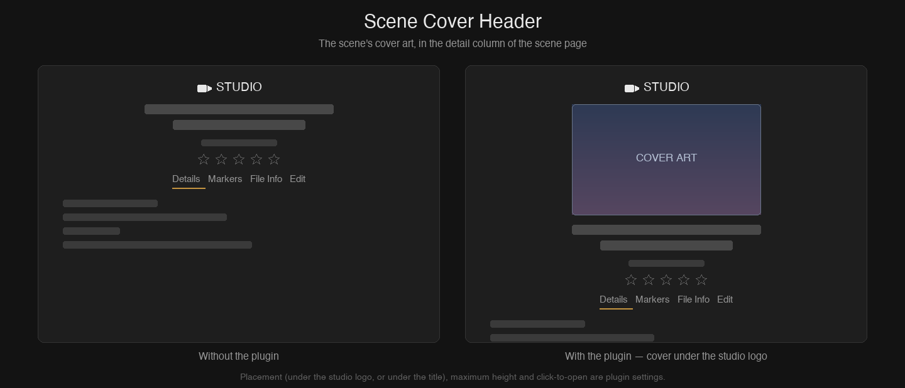

# Scene Cover Header

A Stash UI plugin that shows a scene's **cover art** in the detail column of the scene page (`/scenes/{id}`) — by default right under the studio logo and above the title.

## Why

On the scene page the cover only exists as the player's pre-playback poster, and it is gone the moment you press play — from then on the column that describes the scene shows no artwork at all. Performer, studio and group pages all show their image next to the details; this gives the scene the same treatment, so the cover stays visible while you read the details, browse the tabs or scrub the video.

## How it works

The image is the one Stash already serves for the scene (`/scene/{id}/screenshot`), so nothing is generated, downloaded twice or stored: the player poster uses the same URL, and the browser cache serves both. The exact URL is read from `findScene.paths.screenshot`, which carries Stash's `?t=` cache buster, so re-setting a cover shows up immediately instead of leaving a stale image.

The scene header is a React subtree that re-renders on navigation and on edits, so the insertion is driven by a `MutationObserver` and is idempotent — an image already in place for the current scene is left alone, and one belonging to a scene you have navigated away from is replaced. No component is patched and no core behaviour is changed; removing the plugin leaves no trace.

## Settings

| Setting | Default | |
| --- | --- | --- |
| **Placement** | `studio` | `studio` = under the studio logo, above the title. `title` = under the title. `off` = do not show the cover. |
| **Maximum height (px)** | `240` | Caps the cover's height so it does not push the tabs down. `0` = no limit (full column width). |
| **Click opens the full-size cover** | on | Clicking the cover opens the original image in a new tab. |
| **Refresh the cover after saving a scene** | on | Saving from the scene's Edit tab reloads just this image once the save has succeeded, so a cover changed by that edit is shown right away. The rest of the page is left as it is. |

## Requirements

Stash **v0.31.x** (developed and tested against v0.31.1). The plugin needs only the scene header markup (`.scene-header-container`); there is no backend, no Python and no configuration beyond the settings above.

## Install

1. Copy this folder into your Stash `plugins/` directory (or install from a plugin source that includes it).
2. Settings → Plugins → **Reload plugins**.

## Notes

- A scene with no cover file shows whatever Stash serves for it (its default image). Set a cover, or turn the plugin off for the time being.
- It coexists with plugins that change the player poster, such as [Mosaic Poster](../MosaicPoster) — this one only adds an image to the detail column and never touches the poster.
- When the detail column is collapsed (the chevron between the column and the player) the cover is hidden with it.
- The settings page is English only.
