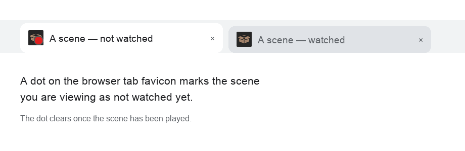

# Unwatched Dot

A Stash UI plugin that puts a **dot on the browser tab favicon** while you are viewing a scene that has not been watched yet (`/scenes/{id}`), so you can tell unseen scenes apart at a glance — even from the tab strip, without looking at the page.

## Why

With many scenes open across tabs, there is no quick way to see which ones you have already watched. The play count is only visible once you focus the tab and look at the page. This marks the favicon itself, so an unwatched scene stands out in the tab strip.

## How it works

On a scene page the plugin reads the scene's `play_count` and `resume_time` from `findScenes`, and if the scene counts as unwatched it overlays a small dot on the bottom-right of the favicon. The favicon is drawn on a `<canvas>` from `/apple-touch-icon.png` and swapped in as a data URL on a single `link[rel=icon]`; on a watched scene, or any non-scene page, the plain favicon is restored.

Drawing is done with `canvas`, not `requestAnimationFrame`, so the favicon is still updated for a scene opened in a **background tab** (rAF is paused while a tab is hidden). The scene page is a React subtree that re-renders on navigation, so evaluation is driven by `history.pushState`/`replaceState`/`popstate` hooks and a `MutationObserver`. No component is patched and no core behaviour is changed; removing the plugin leaves no trace.

## Settings

| Setting | Default | |
| --- | --- | --- |
| **Treat partially-watched as watched** | on | When on, a scene you have started (it has a resume position) counts as watched and shows no dot. When off, only the play count matters — a scene with 0 plays keeps the dot even if you opened it. |
| **Dot colour** | `#e02020` | Any CSS colour for the favicon dot. |

The settings page is translated into every language Stash ships: the labels, descriptions and the plugin description are swapped at render time from `UnwatchedDot.settings.json`, matched to your Stash interface language (falling back to English).

## Requirements

Stash **v0.31.x** (developed and tested against v0.31.1). Frontend only: there is no backend, no Python and no configuration beyond the settings above.

## Install

1. Copy this folder into your Stash `plugins/` directory (or install from a plugin source that includes it).
2. Settings → Plugins → **Reload plugins**.

## Notes

- The favicon reflects the **currently open scene only**; this does not mark scene cards in lists.
- Because it replaces the favicon, it cannot run alongside another plugin that also changes the favicon (e.g. a "now playing" indicator) — the last one to write wins. Pick one.
- `play_count` is read per scene and cached for the page, so a change to it shows on the next page load.
